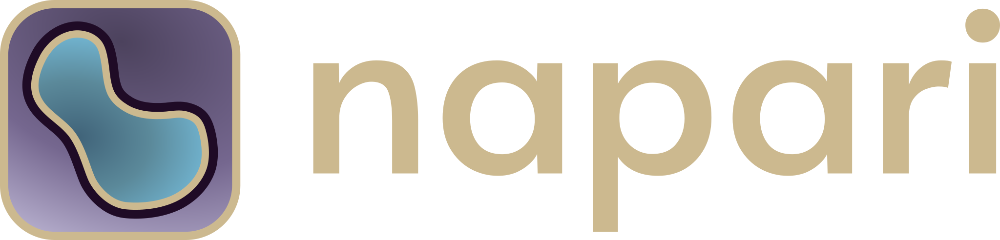
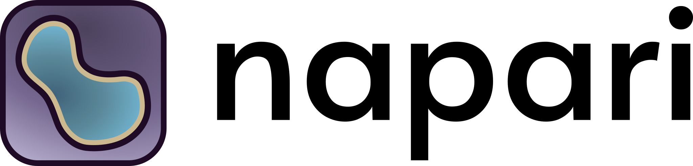

```{=html}


<h1>talks</h1>
<p class="muted">Slides from talks about <a href="https://napari.org">napari</a>, the multi-dimensional image viewer for Python.</p>
<ul class="talks">
  <li><span class="date">2026-11 · CBIAS</span><a href="talks/2026-11-cbias/">You've learned napari. Now meet the people behind it.</a></li>
  <li><span class="date">2026-08 · EuroSciPy</span><a href="talks/2026-08-euroscipy-sample/">(Re)connecting foundational libraries with their communities</a></li>
</ul>
<p class="muted">Built with Quarto and reveal.js. Press <b>T</b> in a deck to switch light / dark.</p>
```
