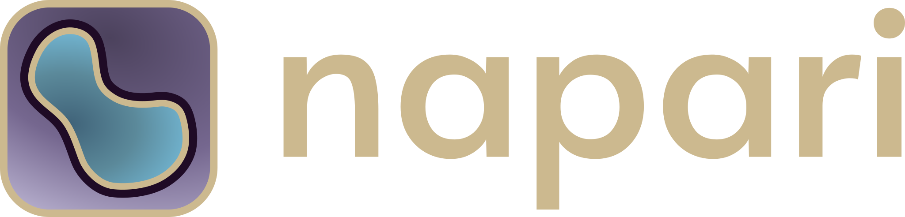

## join the community! {.no-chrome}

:::: {.columns}
::: {.column width="62%"}
::: {.links}
[chat]{.lbl} [napari.zulipchat.com](https://napari.zulipchat.com){.command}

[code]{.lbl} [github.com/napari](https://github.com/napari){.command}

[meet]{.lbl} [bit.ly/napari-meetings](https://bit.ly/napari-meetings){.command}

[learn]{.lbl} [napari.org](https://napari.org){.command}
:::
:::
::: {.column width="38%"}
::: {.panel .people}
[thank you]{.caption}

[[TM]{.tile style="background:var(--logo-sand)"} Tim Monko]{.person}
[[DD]{.tile style="background:var(--logo-lilac)"} Draga Doncila Pop]{.person}
[[LG]{.tile style="background:var(--logo-teal)"} Lorenzo Gaifas]{.person}
[[GB]{.tile style="background:var(--logo-sky)"} Grzegorz Bokota]{.person}

{.only-dark width=150}
{.only-light width=150}
:::
:::
::::
