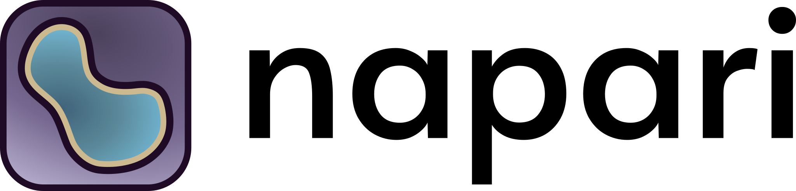
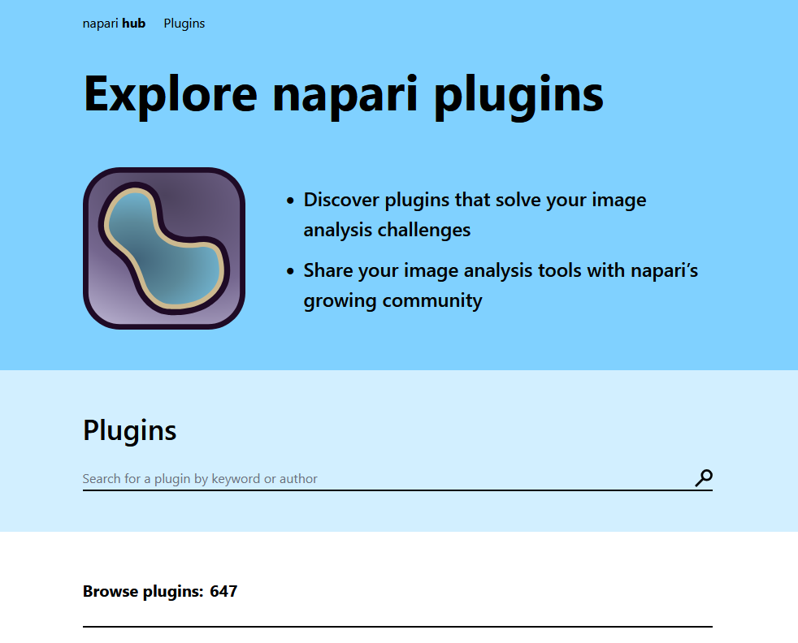
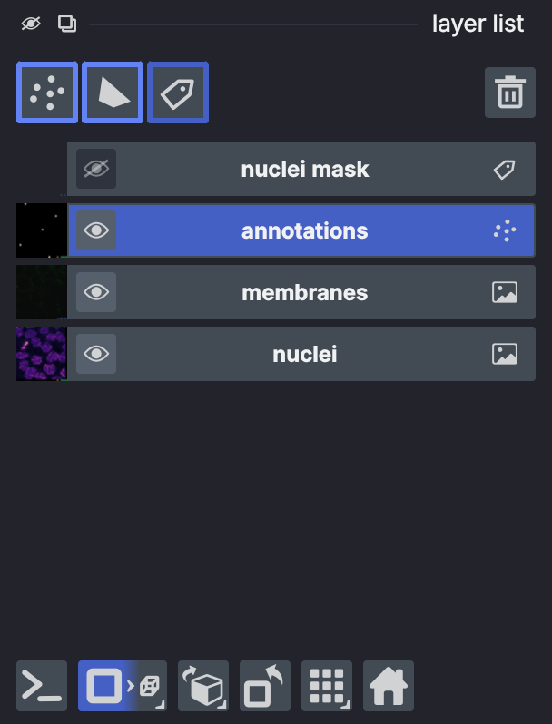
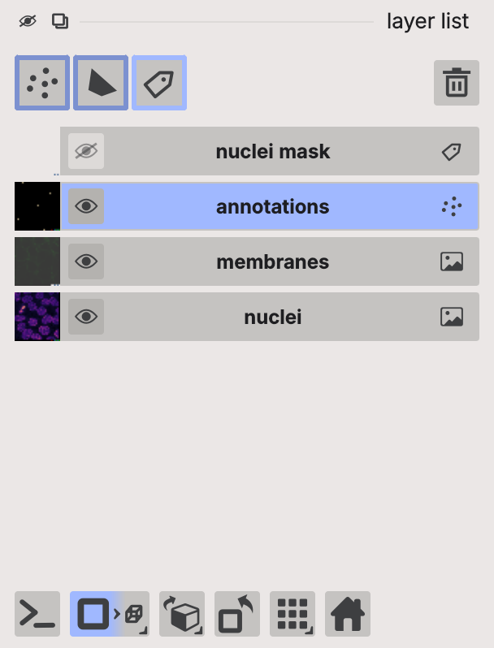
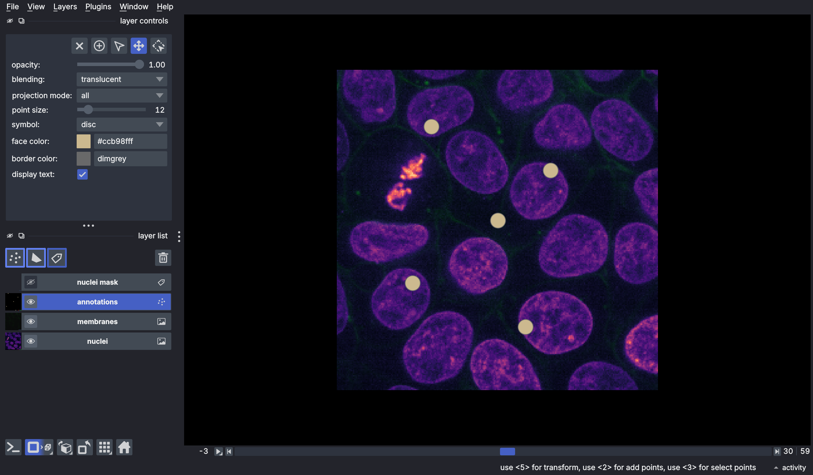
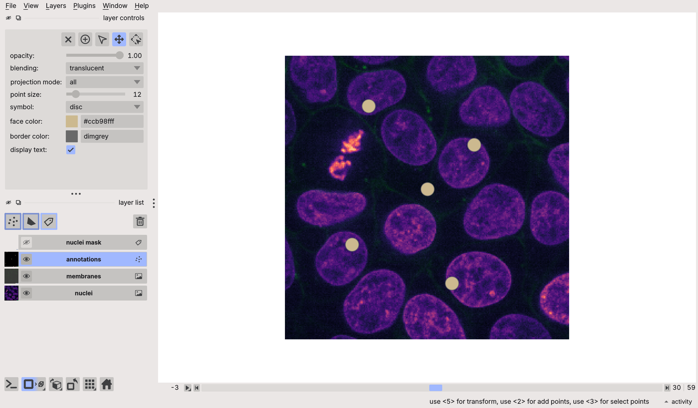

```{python}
#| include: false
import sys
from pathlib import Path
sys.path.insert(0, str(Path("../../shared/style").resolve()))
import pandas as pd
import matplotlib.pyplot as plt
from napari_plots import COLORS, INK, MUTED, use
```

## {.np-title}

::: {.left}
{.only-dark width=200}
{.only-light width=200}

[(Re)connecting foundational libraries with their communities]{.np-h1}

[Successes, failures, and surprises from the napari plugin sustainability initiative]{.np-sub}

[Tim Monko [napari community manager]{.muted}]{.np-who}

[URSSI G-2022-19347 (Sloan Foundation) · CZI 2024-355351]{.caption}
:::

::: {.right}
<video src="../../shared/media/embryo-3d.mp4" autoplay loop muted playsinline></video>

[a tribolium embryo, rendered in 3D in napari]{.caption}
:::

## explore and annotate nD data

<video class="fill" src="../../shared/media/nd-data-weather.mp4" autoplay loop muted playsinline></video>

[uv tool run napari[all]]{.command}

## From plugin user to plugin steward

::: {.kicker}
How I got here
:::

```{=html}
<div class="np-timeline" style="--n:6">
  <div class="ev fragment"><span class="seg"></span><span class="dot"></span><span class="yr">2022</span><span class="what">postdoc; first napari use</span></div>
  <div class="ev fragment"><span class="seg"></span><span class="dot"></span><span class="yr">2023</span><span class="what">solo plugin development</span></div>
  <div class="ev fragment"><span class="seg"></span><span class="dot"></span><span class="yr">2024 · Oct</span><span class="what">first PR to napari</span></div>
  <div class="ev fragment"><span class="seg"></span><span class="dot"></span><span class="yr">2025 · Mar</span><span class="what">core team</span></div>
  <div class="ev fragment now"><span class="seg"></span><span class="dot"></span><span class="yr">2025 · Sep</span><span class="what">plugin sustainability initiative</span></div>
  <div class="ev future"><span class="seg" style="background:none"></span><span class="dot"></span><span class="yr">2026 · Feb</span><span class="what">full-time on napari</span></div>
</div>
```

## A rich plugin ecosystem

:::: {.columns}
::: {.column width="45%"}
- [Over 670 community-built plugins]{.lead}
  - 160+ file formats
  - new widgets and UI
  - AI integrations
  - domain-specific analyses
- Install directly from the viewer
:::
::: {.column width="55%"}

:::
::::

## {.statement}

::: {.fragment .dim-after}
[Problem:]{.accent} as napari and its plugin community drifted apart, the relationship became transactional
:::

::: {.fragment}
[Hypothesis:]{.accent} building a more sustainable ecosystem would benefit both the core team and the community
:::

## 2026 already brought more new contributors than any year since 2021

```{python}
#| output: asis
df = pd.read_csv("data/new_vs_returning.csv")
Path("figures").mkdir(exist_ok=True)
for theme in ("dark", "light"):
    use(theme)
    c = COLORS[theme]
    fig, ax = plt.subplots(figsize=(11.2, 4.6))
    gap = 0.8
    ax.bar(df.year, df.returning, width=0.7, color=c[1])
    ax.bar(df.year, df.new - gap, bottom=df.returning + gap, width=0.7, color=c[0])
    last = df.iloc[-1]
    ax.annotate("2026 so far", (last.year, last.total), xytext=(0, 10),
                textcoords="offset points", ha="center", color=MUTED[theme], fontsize=14)
    ax.text(last.year + 0.48, last.returning / 2, "returning", color=INK[theme], va="center")
    ax.text(last.year + 0.48, last.returning + last.new / 2, "new", color=INK[theme], va="center")
    ax.set_xticks(df.year)
    ax.set_xlim(df.year.min() - 0.6, df.year.max() + 1.6)
    ax.set_ylabel("active contributors")
    fig.savefig(f"figures/contributors-{theme}.svg", bbox_inches="tight")
    plt.close(fig)
    print(f'{{.only-{theme} .plot}}\n')
```

[data: napari GitHub org commits via timmonko/nps · drawn by the cell above at render time]{.caption}

## The layer list, screenshotted from code

:::: {.columns}
::: {.column width="38%"}
{.only-dark .tall}
{.only-light .tall}
:::
::: {.column width="62%"}
- Generated by `shared/demos/screenshots.py`, in both napari themes
- Real widgets, so they always match napari
- Rerun it when the UI changes; no re-cropping
:::
::::

## [Live demo]{.badge} Annotating nuclei in 3D

:::: {.columns}
::: {.column width="58%"}
```python
import napari
from skimage import data

viewer = napari.Viewer(ndisplay=3)
cells = data.cells3d()[:, 1]
viewer.add_image(cells, colormap="magma")
viewer.add_points(ndim=3, name="nuclei")
napari.run()
```
:::
::: {.column width="42%"}
::: {data-demo="points_3d"}
<button class="launch" type="button">▶ Launch napari</button>

[checking for a local runner…]{.runner-status}

<video src="../../shared/media/embryo-3d.mp4" hidden autoplay loop muted playsinline style="margin-top:16px;max-height:300px"></video>
:::
:::
::::

## The viewer, same script

{.only-dark .fill}
{.only-light .fill}


