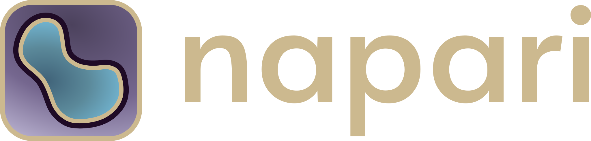
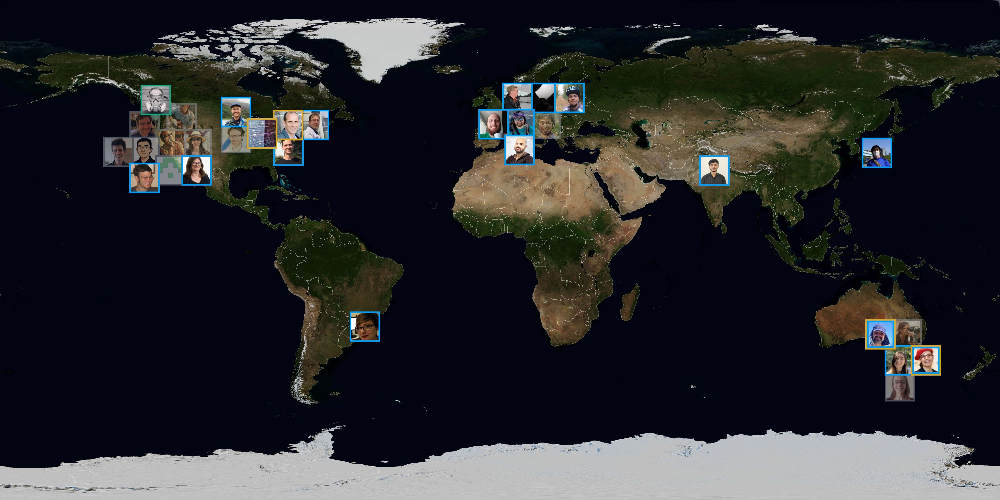
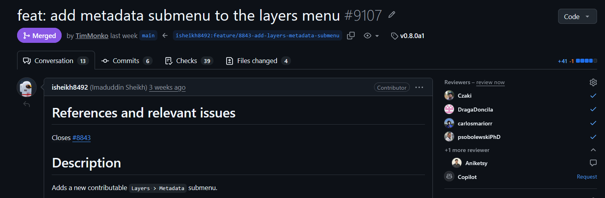
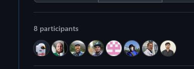

```{python}
#| include: false
from pathlib import Path

import pandas as pd
import segno
from nps import data, plots

# "as of" = the newest data point nps has, so a stale checkout shows up on the slide
AS_OF = max(
    pd.to_datetime(pd.read_csv(data.DATA_DIR / "plugin_versions.csv")["upload_time"], utc=True).max(),
    pd.to_datetime(pd.read_json(data.DATA_DIR / "commits_napari_napari.json")["date"], utc=True).max(),
).strftime("%Y-%m-%d")

FIG = Path("figures")
MEDIA = Path("../../shared/media/generated")


def show(chart, name, cls="plot"):
    """Write <name>-dark/-light.svg and emit both; CSS shows the deck's theme."""
    plots.save(chart, FIG / name)
    for mode in ("dark", "light"):
        print(f"{{.only-{mode} .{cls}}}\n")


def qr(url, name):
    """A QR code as SVG: dark modules on white with a quiet zone, readable in either theme."""
    FIG.mkdir(exist_ok=True)
    segno.make(url, error="m").save(FIG / f"qr-{name}.svg", kind="svg", scale=10, border=2, dark="#1e1e21", light="#ffffff")
    return f"figures/qr-{name}.svg"
```

## {.np-title}

::: {.left}
{.only-dark width=200}
{.only-light width=200}

[There's no u in napari, but there should be!]{.np-h1}

[More than anything, napari is its community: you!]{.np-sub}

[Tim Monko [napari community manager]{.muted}]{.np-who}
:::

::: {.right}
<video src="../../shared/media/embryo-3d.mp4" autoplay loop muted playsinline></video>

[a tribolium embryo, rendered in 3D in napari]{.caption}
:::

::: {.notes}
You've just spent two days with napari. This talk is about the people: who
builds it, how decisions get made, and where you fit in.
:::

# who we are {.statement}

## A small team, spread around the world

```{python}
#| output: asis
if (MEDIA / "team-map.jpg").exists():
    print("{.fill}\n")
else:
    print("[team map goes here: `pixi run -e demos team-map` writes shared/media/generated/team-map.jpg]{.muted}\n")
```

[steering council · core team · triage · emeritus, drawn in napari]{.caption}

::: {.notes}
Every face is a team member, placed near where they live. Frames show roles.
This map is itself a napari example: a NASA Blue Marble Image, country
borders as Shapes, an avatar Image per group, all in latitude/longitude.
:::

## Consensus first, a council as backstop

```{=html}
<div style="display:grid;grid-template-columns:repeat(4,1fr);gap:24px;margin-top:24px">
  <div class="panel fragment"><p class="lead">community</p><p>anyone who uses napari, asks a question, or files an issue</p></div>
  <div class="panel fragment"><p class="lead">triage</p><p>labels and sorts issues, reviews PRs<br><span class="muted">1 member, and we want more</span></p></div>
  <div class="panel fragment"><p class="lead">core team</p><p>sustained contributors who maintain napari with care<br><span class="muted">17 members</span></p></div>
  <div class="panel fragment"><p class="lead">steering council</p><p>resolves deadlocks, strategy, funding, partnerships<br><span class="muted">4 members</span></p></div>
</div>
```

[napari.org/stable/community/governance.html]{.command}

::: {.notes}
napari is consensus-based. Most decisions happen in PR review and discussion.
The steering council only steps in when consensus fails. A few roles are paid
from grants (developers-in-residence, community managers, operations), plus
contracted work with Quansight; most contributions are volunteer.
:::

## 2026 is our biggest year yet: 93 contributors, 61 of them new

```{python}
#| output: asis
show(plots.contributors_by_year(data.contributors_by_year()), "contributors")
```

[contributors to public napari GitHub repos · as of `{python} AS_OF` · data: timmonko/nps]{.caption}

# how work happens {.statement}

## Everything happens in the open

:::: {.columns}
::: {.column width="50%"}
::: {.links}
[talk]{.lbl} Zulip: questions, design, release coordination

[build]{.lbl} GitHub: issues, PRs, review, triage labels

[meet]{.lbl} community meetings and working groups, open to all

[record]{.lbl} meeting notes in napari/meeting-notes
:::
:::
::: {.column width="50%"}
::: {.panel}
[working groups]{.caption}

- Bundled application
- Documentation
- Graphs layer
- Plugins

[at least two co-leads and a core sponsor; anyone can start one]{.muted}
:::
:::
::::

::: {.notes}
Nothing is decided behind closed doors. Zulip is where conversation lives;
GitHub is where it lands. Meetings are on the public calendar in several time
zones.
:::

## A first PR: five reviewers, merged in ten days

{width=100%}

::: {style="display:flex;gap:32px;align-items:center;margin-top:16px"}
{width=360}

[a newcomer's first napari PR, opened 2026-06-27, merged 2026-07-07, shipped in 0.8.0a1]{.caption}
:::

::: {.notes}
This is what contributing looks like. A newcomer picked up an open issue,
opened their first PR, and five people from across the team reviewed it,
including a steering council member. Ten days later it was merged and in the next release. Eight
people took part. You don't need permission to start.
:::

# plugins and ecosystem {.statement}

## Over 700 plugins, and 2026 is already the biggest year

```{python}
#| output: asis
show(plots.new_plugins_by_year(data.new_plugins_by_year()), "new-plugins")
```

[napari plugins on PyPI · as of `{python} AS_OF` · data: timmonko/nps]{.caption}

## Half of the living plugins shipped a release in the last six months

```{python}
#| output: asis
show(plots.plugin_status(data.plugin_status()), "plugin-status")
```

[living = a release in the past 2 years; that share was 35% in mid-2024 · as of `{python} AS_OF` · data: timmonko/nps]{.caption}

::: {.notes}
Every plugin ever released, stacked by when it last shipped. The top is the
total, still climbing. The blue band is plugins released in the last six
months: flat at 120-150 for years, now about 200. Of plugins that have done
anything in two years, the share releasing recently went from about a third
in 2024 to about half now. The grey band is the long tail of one-off thesis
plugins. That's fine, but it means the ecosystem needs maintainers, not just
authors.
:::

# work with us {.statement}

## What we can do together

```{=html}
<div style="display:grid;grid-template-columns:repeat(3,1fr);gap:24px;margin-top:24px">
  <div class="panel fragment"><p class="lead">amplify</p><p>your plugin, paper or workflow on the Island Dispatch blog, napari.org and our socials</p></div>
  <div class="panel fragment"><p class="lead">co-maintain</p><p>keep your plugin working as napari changes; review, migration help, shared tooling</p></div>
  <div class="panel fragment"><p class="lead">fund</p><p>write grants together; napari's own roles are grant-funded</p></div>
</div>
```

::: {.notes}
The plugin community and the core team need each other. We'd rather hear
about your work than find it by accident.
:::

## Your first steps

```{python}
#| output: asis
steps = [
    ("say hi", "napari.zulipchat.com", "https://napari.zulipchat.com"),
    ("come to a meeting", "bit.ly/napari-meetings", "https://bit.ly/napari-meetings"),
    ("start contributing", "napari.org/stable/developers/contributing", "https://napari.org/stable/developers/contributing/index.html"),
]
print('::: {style="display:grid;grid-template-columns:repeat(3,1fr);gap:32px;margin-top:16px;text-align:center"}\n')
for i, (what, label, url) in enumerate(steps):
    print(f'::: {{.fragment}}\n)}){{width=220}}\n\n[{what}]{{.lead}}\n\n[{label}]{{.command}}\n:::\n')
print(":::\n")
```

::: {.notes}
Lowest bar first: introduce yourself on Zulip and tell us what you work on.
Then come to a community meeting. When you're ready, the contributing guide
walks you from a dev install to your first PR, and points at good first issues.
:::


