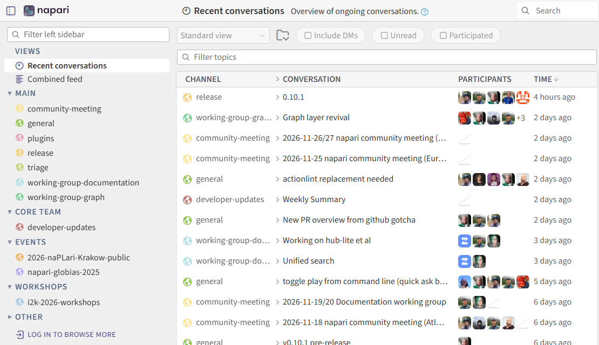
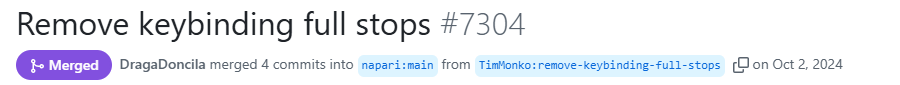
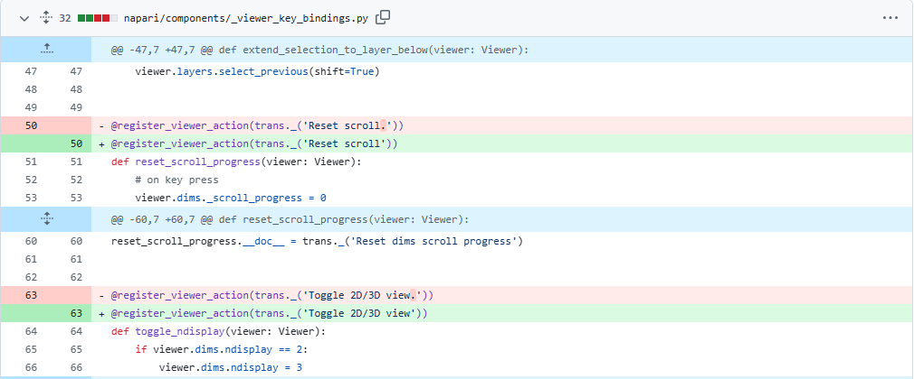

```{python}
#| include: false
from pathlib import Path

import pandas as pd
import segno
from nps import data, plots

# "as of" = the newest data point nps has, so a stale checkout shows up on the slide
AS_OF = max(
    pd.to_datetime(pd.read_csv(data.DATA_DIR / "plugin_versions.csv")["upload_time"], utc=True).max(),
    pd.to_datetime(pd.read_json(data.DATA_DIR / "commits_napari_napari.json")["date"], utc=True).max(),
).strftime("%Y-%m-%d")

FIG = Path("figures")
MEDIA = Path("../../shared/media/generated")

CONTRIB = data.contributors_by_year()
THIS_YEAR = int(CONTRIB["year"].max())
_now = CONTRIB[CONTRIB["year"] == THIS_YEAR].set_index("kind")["contributors"]
N_CONTRIB, N_NEW = int(_now.sum()), int(_now["New"])

PLUGINS = data.new_plugins_by_year()
N_PLUGINS = int(PLUGINS["total_plugins"].max())

MEETINGS = "https://napari.org/stable/community/meeting_schedule.html"


def show(chart, name, cls="plot"):
    """Write <name>-dark/-light.svg and emit both; CSS shows the deck's theme."""
    plots.save(chart, FIG / name)
    for mode in ("dark", "light"):
        print(f"{{.only-{mode} .{cls}}}\n")


def qr(url, name):
    """A QR code as SVG: dark modules on white with a quiet zone, readable in either theme."""
    FIG.mkdir(exist_ok=True)
    segno.make(url, error="m").save(FIG / f"qr-{name}.svg", kind="svg", scale=10, border=2, dark="#1e1e21", light="#ffffff")
    return f"figures/qr-{name}.svg"
```

## {.np-title}

::: {.left}
{.only-dark width=200}
{.only-light width=200}

[From napari to You and Back]{.np-h1}

[How to contribute]{.np-sub}

[Tim Monko [napari community manager]{.muted}]{.np-who}
:::

::: {.right}
<video src="../../shared/media/embryo-3d.mp4" autoplay loop muted playsinline></video>

[a tribolium embryo, rendered in 3D in napari]{.caption}
:::

## How I got here

```{=html}
<div class="np-timeline" style="--n:6">
  <div class="ev fragment"><span class="seg"></span><span class="dot"></span><span class="yr">2023</span><span class="what">solo plugin development</span></div>
  <div class="ev fragment"><span class="seg"></span><span class="dot"></span><span class="yr">2024 · Oct</span><span class="what">first PR to napari</span></div>
  <div class="ev fragment"><span class="seg"></span><span class="dot"></span><span class="yr">2025 · Mar</span><span class="what">invited to the core team</span></div>
  <div class="ev fragment"><span class="seg"></span><span class="dot"></span><span class="yr">2025 · May</span><span class="what">community manager</span></div>
  <div class="ev fragment"><span class="seg"></span><span class="dot"></span><span class="yr">2025 · Sep</span><span class="what">plugin sustainability initiative</span></div>
  <div class="ev fragment now"><span class="seg"></span><span class="dot"></span><span class="yr">2026 · Feb</span><span class="what">full time on napari</span></div>
</div>
```

::: {.notes}
Each step was a different role: plugin author, contributor, maintainer,
community manager. You can be any of these, and stop at any of them.
:::

## Today: one of four people paid to work on napari

```{=html}
<div style="display:grid;grid-template-columns:repeat(4,1fr);gap:32px;margin-top:40px;text-align:center">
  <div><p class="lead">Tim Monko</p><p class="muted">operations · community manager · developer</p></div>
  <div><p class="lead">Draga Doncila Pop</p><p class="muted">operations</p></div>
  <div><p class="lead">Grzegorz Bokota</p><p class="muted">developer</p></div>
  <div><p class="lead">Lorenzo Gaifas</p><p class="muted">developer</p></div>
</div>
```

[four contractors, about three full-time equivalents, on a CZI grant]{.caption}

## But napari is mostly volunteers

```{python}
#| output: asis
if (MEDIA / "team-map.jpg").exists():
    print("{.fill}\n")
else:
    print("[team map goes here: `pixi run -e demos team-map` writes shared/media/generated/team-map.jpg]{.muted}\n")
```

[steering council · core team · triage · emeritus, drawn in napari]{.caption}

::: {.notes}
Every face is a team member, placed near where they live. Most of them are
not paid to work on napari.
:::

## An independent project, funded by grants

```{=html}
<div class="np-timeline" style="--n:4">
  <div class="ev fragment"><span class="seg"></span><span class="dot"></span><span class="yr">2018</span><span class="what">started by researchers at CZ Biohub and Monash University</span></div>
  <div class="ev fragment"><span class="seg"></span><span class="dot"></span><span class="yr">2019 – 2023</span><span class="what">CZI staff build napari alongside the community</span></div>
  <div class="ev fragment"><span class="seg"></span><span class="dot"></span><span class="yr">2021 – 2025</span><span class="what">CZI runs the napari hub</span></div>
  <div class="ev fragment now"><span class="seg"></span><span class="dot"></span><span class="yr">2025 – 2028</span><span class="what">a CZI grant to the independent project</span></div>
</div>
```

[fiscal home: NumFOCUS · napari.org/stable/community/funding.html]{.caption}

::: {.notes}
CZI's own team stepped back at the end of 2023. Since then napari is run by
its community and funded by grants: seed sustainability (2022-2025, $200k),
now scaffolding sustainability (2025-2028, $1.7M), which pays the four of us.
Funders hold one seat on the steering council.
:::

## So who decides?

```{=html}
<div style="display:grid;grid-template-columns:repeat(3,1fr);gap:24px;margin-top:24px">
  <div class="panel fragment"><p class="lead">community</p><p>anyone who uses napari, asks a question, files an issue or opens a PR</p></div>
  <div class="panel fragment"><p class="lead">core team</p><p>sustained contributors who maintain napari and decide by consensus<br><span class="muted">17 members</span></p></div>
  <div class="panel fragment"><p class="lead">steering council</p><p>steps in when consensus fails; strategy, funding, partnerships<br><span class="muted">4 members</span></p></div>
</div>
```

[napari.org/stable/community/governance.html]{.command}

## `{python} THIS_YEAR` is our biggest year yet: `{python} N_CONTRIB` contributors, `{python} N_NEW` of them new

```{python}
#| output: asis
show(plots.contributors_by_year(CONTRIB), "contributors")
```

[contributors to public napari GitHub repos · as of `{python} AS_OF` · data: timmonko/nps]{.caption}

## Every release since 0.7.0 brought someone new

```{python}
#| output: asis
show(plots.release_contributors(data.release_contributors()), "release-contributors")
```

[bar width = release cycle, area = people in the release notes · as of `{python} AS_OF` · data: timmonko/nps]{.caption}

::: {.notes}
We moved to monthly releases this autumn. Each bar is one release: the wider,
the longer the cycle; the taller, the more people per month.
:::

## `{python} N_PLUGINS` plugins: the ecosystem needs maintainers, not just authors

```{python}
#| output: asis
show(plots.new_plugins_by_year(PLUGINS), "new-plugins")
```

[napari plugins on PyPI · as of `{python} AS_OF` · data: timmonko/nps]{.caption}

## Start by showing up

:::: {.columns}
::: {.column width="62%"}
{width=100%}

[napari.zulipchat.com]{.lead style="font-size:1.6em"}
:::
::: {.column width="38%"}
::: {.links}
[chat]{.lbl} napari.zulipchat.com

[meet]{.lbl} community meetings; docs, plugin and graph layer working groups

[ask]{.lbl} forum.image.sc, tag: napari
:::

```{python}
#| output: asis
print(f'\n')
```

[meeting schedule]{.caption}
:::
::::

::: {.notes}
Type napari.zulipchat.com with me now. You can read it without an account.
Meetings are open to everyone and run in several time zones.
:::

## A first PR can be tiny

{width=70%}

{width=68%}

[my first napari PR: removing 25 full stops, merged in two days]{.caption}

## GitHub needs contributions and reviews

```{=html}
<div style="display:grid;grid-template-columns:repeat(2,1fr);gap:32px;margin-top:24px">
  <div class="panel"><p class="lead">contribute</p><p>issues, docs, examples, fixes, features</p></div>
  <div class="panel"><p class="lead">review</p><p>anyone can review a PR: try it, read it, say what you see. We need this most.</p></div>
</div>
```

[github.com/napari/napari]{.command}

## We want more triagers

```{=html}
<div style="display:grid;grid-template-columns:repeat(2,1fr);gap:32px;margin-top:24px">
  <div class="panel"><p class="lead">triage team</p><p>labels and sorts issues, reviews PRs<br><span class="muted">join: tell the core team you're interested</span></p></div>
  <div class="panel"><p class="lead">core team</p><p>maintains napari and makes decisions<br><span class="muted">join: nominated after sustained contributions</span></p></div>
</div>
```

::: {.notes}
We're re-evaluating how we recognise contributors and what the core team
means.
:::

## Hack with us

[a yearly hackathon, likely in Europe next year]{.lead}

[watch Zulip for the announcement]{.muted}

## Help us stay sustainable

[we're looking to host workshops, and we're open to other funding]{.lead}

[reach out to me: Tim Monko on napari.zulipchat.com]{.muted}

## Thank you! Pick one: {.no-chrome}

::: {.links}
[chat]{.lbl} say hi on [napari.zulipchat.com](https://napari.zulipchat.com){.command}

[meet]{.lbl} come to a [community meeting](https://napari.org/stable/community/meeting_schedule.html){.command}

[review]{.lbl} review a PR on [github.com/napari](https://github.com/napari){.command}

[learn]{.lbl} [napari.org](https://napari.org){.command}
:::

{.only-dark width=200}
{.only-light width=200}
